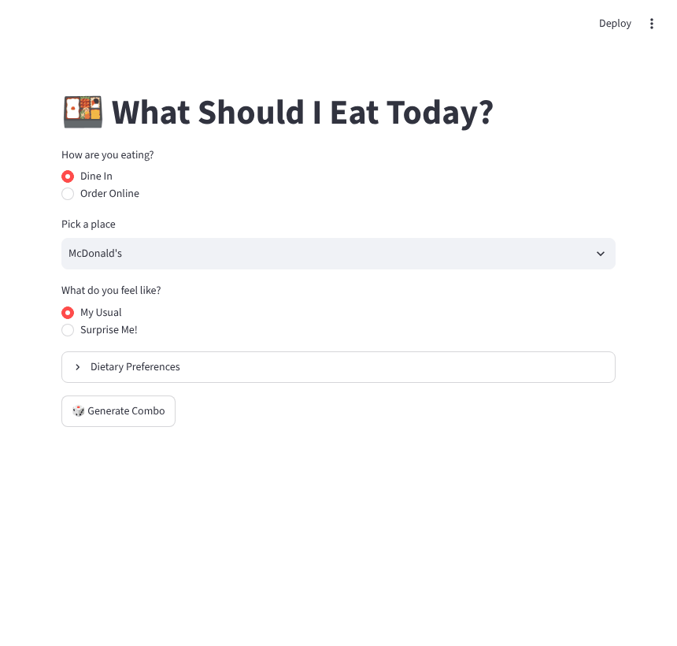

<div align="center">



**"What should I eat today?" answered in one click, and built so that people who can't easily read a menu can use it too.**

[](https://one-click-crave.base44.app/)


</div>

---

## Try it

**[one-click-crave.base44.app](https://one-click-crave.base44.app/)**

This is the current version of One Click Crave, rebuilt from the ground up on Base44. It does three things:

| | |
|---|---|
| **Order for delivery** | The AI puts together a meal to be delivered to your door |
| **Decide for dining out** | It builds a personalised combo you can show your waiter |
| **Ask the concierge** | Chat with the AI for a recommendation that fits what you feel like |

Alongside those sit a rankings screen, the chat itself and a preferences screen where you set what you do and don't eat.

---

## Six months of testing

One Click Crave was built with a Design Thinking approach: put it in front of people, watch where they get stuck, fix that, and go back. That loop ran for about six months.

The testing was done with the people a food app usually leaves out:

- **Blind users**, who can't read a menu on a screen
- **Deaf users**
- **Residents of old-age homes**
- **School students**

What they showed us shaped the product more than any feature idea did. The changes that came out of it:

- **Text-to-speech**, so the menu and the suggestion can be heard instead of read
- **Large menus and bright, high-contrast overlays**, so the options are easy to see
- **Fewer steps**, so getting from "I'm hungry" to a decision takes one tap wherever possible

The aim through all of it was the same: make it easier, then make it better, then test it again.

---

## The first version (this repo)

The code here is the original Streamlit app that the idea started from. `One Click Crave (old)/` keeps the earliest version for reference.

<div align="center">



<sub>Recorded from a local run of the Streamlit app.</sub>

</div>

| | |
|---|---|
| **Dine in or order online** | Pick how you're eating and which restaurant |
| **Surprise me** | A random combo built from the menu, one item per category |
| **My usual** | A logistic-regression model trained on your logged orders predicts your usual; falls back to a rule-based combo if there isn't enough history |
| **Dietary filters** | Vegetarian only, no onion, no garlic, low spice |
| **Quick search links** | For online orders, a one-click search for each item on Swiggy |
| **Learns from you** | Confirm a meal and it's saved to `order_history.csv` for next time |

Built-in menus: McDonald's, Taco Bell, Starbucks, Domino's, Kimling, Third Wave Coffee, Kiosk Kaffee and Demitasse.

### Quick start

```bash
git clone https://github.com/aryankhanna1409/one-click-crave.git
cd "one-click-crave/One Click Crave"

pip install -r requirements.txt
streamlit run app.py
```

### Project layout

| File | Role |
|---|---|
| `app.py` | Streamlit interface (the browser tab is titled **MealMuse**) |
| `combo_generator.py` | Rule-based combos, the ML prediction and order logging |
| `swiggy_linker.py` | Builds the search links for online ordering |
| `menu_data.json` | Restaurants and their menus by category |
| `user_prefs.json` | Your dietary preferences |
| `order_history.csv` | Past orders used to train the "usual" model |

---

<div align="center">


Because choosing is the hardest part of dinner

<sub>Part of <a href="https://github.com/aryankhanna1409">Aryan Khanna's portfolio</a>: one loop, five pours, from robots to AI systems.</sub>

</div>
